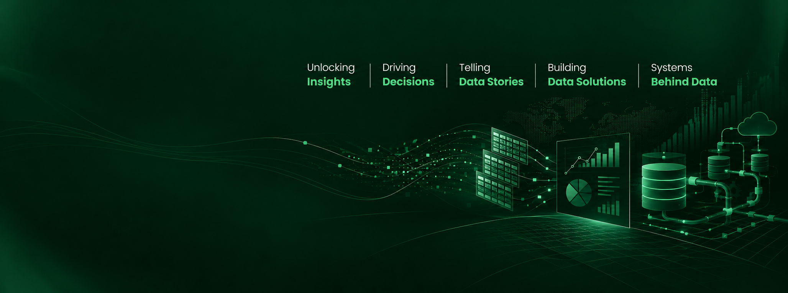

    

I approach data by first understanding the problem, asking the right questions, and designing solutions that create business value.

With a background in Economics and Business Management and experience in financial services and operational environments, I bring business understanding to my growing technical skills in Data Analytics and Data Engineering.

My portfolio demonstrates my work with SQL, data analysis, ETL pipelines, data modelling, and data warehousing, with a focus on building reliable solutions that turn raw data into useful information.

## 🚀 Current Focus

* Building practical data solutions using SQL and SQL Server.
* Developing ETL pipelines and understanding reliable, repeatable data processing.
* Applying Medallion Architecture and dimensional modelling in data warehouse projects.
* Strengthening Python skills and learning Azure data technologies.
* Exploring how well-designed data systems improve business efficiency and decision-making.

## 📊 Featured Projects

### 🛒 Drivers of Sales Performance
Conducted exploratory data analysis and business analysis using SQL to evaluate how store characteristics, promotions, seasonality, and economic indicators influence retail sales performance.

### 🛍️ Kasi Mart Data Engineering Project

Built a Snowflake-based mini retail data project using customers, products, and orders tables to practise data ingestion, dimensional relationships, joins, and business analysis.

### 🛒 Olist Data Warehouse Solution

Built an end-to-end e-commerce data warehouse to help managers track key performance indicators, monitor business performance, and make informed decisions using structured data. Focused on data ingestion, ETL pipelines, Medallion Architecture, and dimensional modelling using SQL Server and SSIS.

## 🧰 Tools & Technologies

**Analytics**
* SQL
* Excel
* Power BI

**Data Engineering**

* SQL Server
* SSIS (SQL Server Integration Services)
* Snowflake
* Databricks
* ETL Pipelines
* Data Modelling
* Azure(Currenly learning)

## 📈 Data Skills 
* Data Cleaning and Transformation
* Exploratory Data Analysis (EDA)
* Data Quality Assessment
* Dimensional Modelling
* Data Warehousing
* Business Analysis and Data-Driven Decision-Making

## 🤝 Connect With Me
- https://www.linkedin.com/in/rofhiwa-muthivhi

